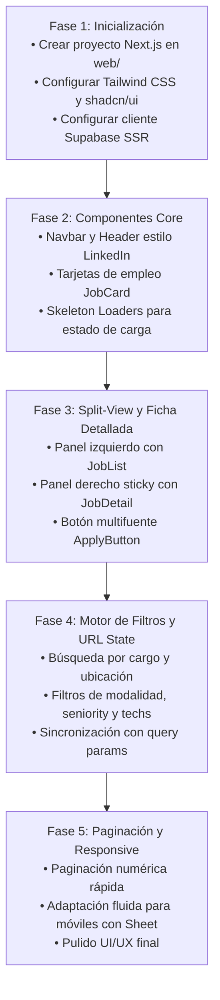

# Plan de Desarrollo: Frontend & Backend con Next.js para Buscador de Empleos (Estilo LinkedIn)

Este plan detalla la arquitectura, experiencia de usuario (UI/UX), estructura de componentes y fases de implementación para construir una aplicación web moderna, rápida y full-stack utilizando únicamente **Next.js (App Router)** conectado directamente a **Supabase**.

---

## 1. Visión del Producto y Experiencia UI/UX (Estilo LinkedIn)

### A. Estética Visual y Paleta (Tema Claro)
* **Inspiración LinkedIn**: Diseño corporativo, limpio, confiable y enfocado en la legibilidad y escaneo rápido de vacantes.
* **Colores Principales**:
  * **Fondo Principal**: `#f3f2ef` (el clásico gris cálido sutil de LinkedIn).
  * **Tarjetas y Superficies**: `#ffffff` con bordes ultrafinos (`border-slate-200`) y sombras suaves (`shadow-sm`).
  * **Primario / Acento**: Azul corporativo `#0a66c2` (hover `#004182`).
  * **Texto Principal**: `#191919` (alto contraste y nitidez tipográfica).
  * **Texto Secundario**: `#666666` para metadatos, fechas y ciudades.
  * **Badges y Etiquetas**: Verde esmeralda suave para modalidades remotas (`bg-emerald-50 text-emerald-700`), morado suave para salarios (`bg-indigo-50 text-indigo-700`).

### B. Distribución de Pantalla (Split-View Desktop)
* **Barra de Navegación Superior**:
  * Logotipo del buscador de empleos.
  * Barra de búsqueda dual:
    * `Input 1`: Cargo, palabra clave o tecnología (ej. "Python Developer", "React").
    * `Input 2`: Ubicación o modalidad (ej. "Remoto", "Bogotá", "Colombia").
    * Botón de búsqueda rápida con debounce automático.
* **Cinta de Filtros Rápidos (Chips)**:
  * Modalidad (`Remoto`, `Híbrido`, `Presencial`).
  * Nivel de Experiencia (`Junior`, `Semi-Senior`, `Senior`, `Lead`).
  * Rango Salarial (slider o rangos predefinidos).
  * Tecnologías (badges seleccionables de las más demandadas).
  * Ordenar por: Más recientes / Relevancia.
* **Layout Principal Dividido (Pantallas Grandes)**:
  * **Panel Izquierdo (40% - 45%)**: Lista scrolleable de tarjetas de ofertas compactas. Cada tarjeta incluye:
    * Logo de la empresa (o inicial en avatar circular con fondo suave).
    * Título del cargo con hover azul.
    * Empresa y ubicación.
    * Badges de modalidad y salario.
    * **Pills multifuente**: Indicadores visuales de dónde está publicada (ej. `GetOnBrd`, `CompuTrabajo`, `Remotive`).
    * Tiempo relativo ("Publicado hace 2 días").
  * **Panel Derecho (55% - 60% Sticky)**: Ficha de detalle de la oferta seleccionada:
    * Encabezado con título grande, empresa, ubicación y salario destacado.
    * **Botón principal "Postularse"**: Si la oferta proviene de varios portales, muestra un menú desplegable con enlaces directos: *"Postular en GetOnBrd"* y *"Postular en CompuTrabajo"*.
    * Botón secundario *"Guardar vacante"* / *"Compartir enlace"*.
    * Pestañas/Secciones claras: **Descripción del Cargo**, **Requisitos**, **Tecnologías requeridas** y **Beneficios**.
* **Diseño Móvil**:
  * Lista de tarjetas que, al pulsarse, abre la ficha completa en un Sheet/Drawer o página dedicada con botón de retorno fluido.

---

## 2. Arquitectura Tecnológica

* **Framework**: **Next.js 15 (App Router)**.
* **Lenguaje**: **TypeScript**.
* **Estilos y Componentes**:
  * **Tailwind CSS v4** para diseño utilitario responsivo.
  * **shadcn/ui** (Radix UI) para componentes accesibles: Dialogs, Sheets, Dropdowns, Badges, Tooltips, Skeletons de carga.
  * **Lucide React** para iconografía moderna.
* **Capa de Datos**:
  * **@supabase/ssr**: Consultas directas desde Server Components (cero API intermedias necesarias, carga en milisegundos y SEO optimizado).
  * Paginación en servidor y soporte de Full-Text Search aprovechando el índice `idx_jobs_search` de PostgreSQL.
* **Gestión de Estado y URL**:
  * **nuqs** (o `useSearchParams` nativo de Next.js) para sincronizar filtros y paginación directamente con la URL (`/jobs?q=python&remote=true&seniority=senior&page=1`), permitiendo compartir búsquedas o recargar sin perder el estado.

---

## 3. Estructura de Carpetas Propuesta

Se creará una carpeta `web/` en el proyecto para aislar el frontend Next.js del motor de scraping en Python:

```text
scraper-jobs/
├── src/                      # Motor de Scraping en Python
├── supabase/                 # Esquema DDL y migraciones
├── web/                      # Aplicación Next.js Full-Stack
│   ├── app/
│   │   ├── layout.tsx        # Layout general (fuente Inter, navbar global, metadata SEO)
│   │   ├── page.tsx          # Página principal (Split View: filtros + lista + detalle)
│   │   ├── job/[id]/         # Vista individual optimizada para móviles o compartir
│   │   └── api/              # (Opcional) Webhooks o endpoints auxiliares
│   ├── components/
│   │   ├── layout/
│   │   │   ├── Navbar.tsx    # Barra de navegación estilo LinkedIn
│   │   │   └── SearchBar.tsx # Barra de búsqueda dual (Cargo + Ubicación)
│   │   ├── jobs/
│   │   │   ├── JobList.tsx   # Lista scrolleable de tarjetas
│   │   │   ├── JobCard.tsx   # Tarjeta individual con badges y logos
│   │   │   ├── JobDetail.tsx # Panel lateral sticky con detalles completos
│   │   │   ├── ApplyButton.tsx# Botón inteligente de postulación multifuente
│   │   │   ├── JobFilters.tsx# Barra de chips y modal de filtros avanzados
│   │   │   └── Pagination.tsx# Controles de paginación numérica
│   │   └── ui/               # Componentes de shadcn (Button, Badge, Skeleton, Dialog)
│   ├── lib/
│   │   ├── supabase/
│   │   │   ├── server.ts     # Cliente Supabase para Server Components
│   │   │   └── client.ts     # Cliente Supabase para Client Components
│   │   ├── types.ts          # Tipos TypeScript mapeados desde schema.sql
│   │   └── utils.ts          # Formateadores de moneda, fechas relativas y texto
│   ├── package.json
│   ├── tailwind.config.ts
│   └── tsconfig.json
```

---

## 4. Consultas y Filtros en Supabase

El backend en Next.js aprovechará directamente las columnas e índices que creamos en Supabase:

1. **Búsqueda por Texto**:
   * Utiliza `textSearch('title', query)` o la función de texto completo de PostgreSQL.
2. **Filtro de Modalidad**:
   * `.eq('is_remote', true)` o `.eq('workplace_type', 'remote' | 'hybrid' | 'on_site')`.
3. **Filtro de Seniority**:
   * `.in('seniority_level', selectedSeniorities)`.
4. **Filtro de Tecnologías**:
   * Uso del operador `@>` de JSONB: `.contains('technologies', [selectedTech])`.
5. **Paginación Eficiente**:
   * Consulta con `.range(from, to)` y `count: 'exact'` para calcular el total de páginas.
6. **Filtro de Ofertas Activas**:
   * Siempre filtrado por `.eq('status', 'active')` para no mostrar empleos cerrados.

---

## 5. Fases de Ejecución Paso a Paso



### Fase 1: Inicialización del Proyecto Next.js
* Crear la aplicación Next.js con TypeScript, Tailwind CSS y App Router en la carpeta `web/`.
* Instalar dependencias esenciales:
  ```bash
  npm install @supabase/ssr @supabase/supabase-js lucide-react class-variance-authority clsx tailwind-merge date-fns
  ```
* Configurar variables de entorno en `web/.env.local` con las credenciales de Supabase existentes.

### Fase 2: Componentes Base de UI
* Configurar componentes de diseño de shadcn/ui: botones, badges, separadores, tarjetas y skeletons de carga.
* Crear el componente `JobCard`:
  * Manejo elegante de empresas sin logo (avatar con inicial y paleta de colores aleatoria pero determinista).
  * Formateo de fechas relativas (ej. "hace 3 horas", "hace 1 día").
  * Visualización de badges de fuentes (`GetOnBrd`, `CompuTrabajo`, etc.).

### Fase 3: Layout Split-View y Detalle de la Oferta
* Implementar el layout de dos columnas estilo LinkedIn en `app/page.tsx`.
* Construir `JobDetail`:
  * Renderizado seguro del texto o HTML de la oferta.
  * Lista de etiquetas de tecnologías con opción de hacer click para filtrar.
  * Desplegable inteligente de postulación cuando existen múltiples fuentes.

### Fase 4: Búsqueda, Filtros y Sincronización con la URL
* Crear la barra de filtros con chips interactivos.
* Implementar debounce para la búsqueda de texto para evitar saturación de peticiones.
* Sincronizar todos los filtros con la URL (`useRouter` / `useSearchParams`) para permitir enlaces compartibles y navegación con botón "Atrás".

### Fase 5: Paginación y Optimización Móvil
* Controles de paginación con indicación de resultados (ej. "Mostrando 1-20 de 142 empleos").
* Implementar vista Drawer / Sheet para pantallas móviles.
* Pruebas de velocidad y refinamiento visual.

